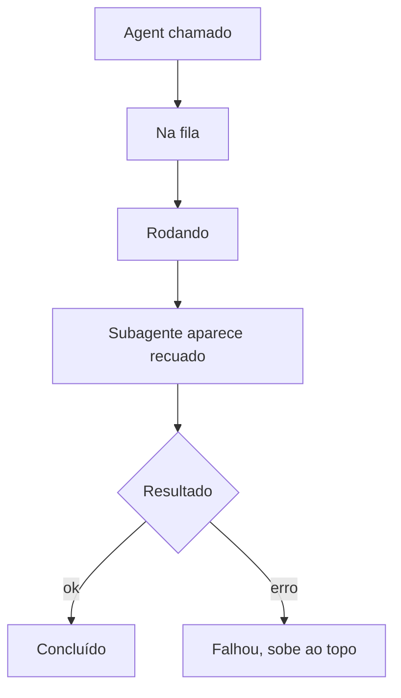
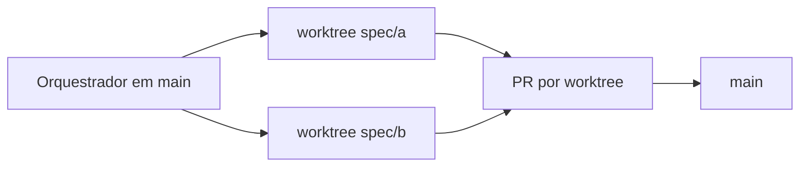
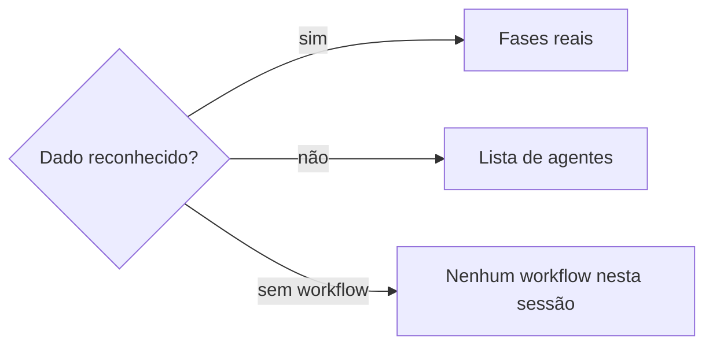
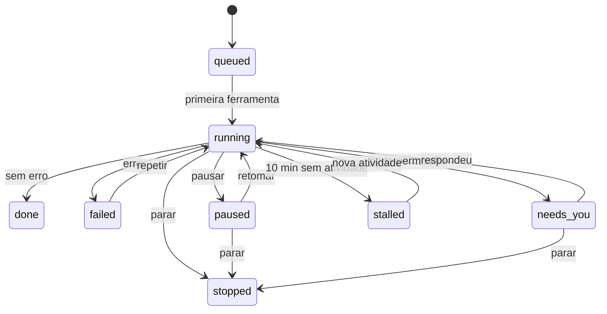
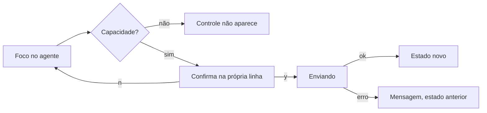
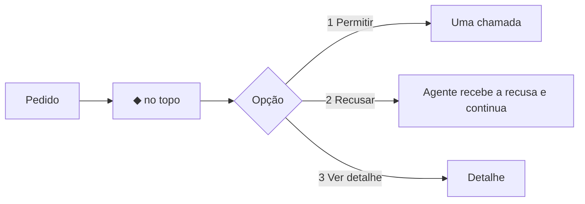

# Fluxos — office-agent-monitor-v2

Base: Flows5 e Foundations5.

## FLOW-001 Agente e subagente
Ator: quem roda a sessão. Gatilho: `tool.call` de Agent. Passos: spawn, primeira ferramenta, filhos, fim. Estado final: árvore com o resultado de cada nó. Desvio: pai ausente vira raiz.

## FLOW-002 Worktree
Ator: quem acompanha. Gatilho: agente isolado ou caminho dentro de worktree. Passos: reconhecer, agrupar, contar, integrar fora do painel. Estado final: grupo com saúde da branch. Desvio: sem git, sem contagem.

## FLOW-003 Workflow
Ator: quem roda workflow. Gatilho: evento provado em T-001. Passos: detectar, listar fases, atualizar. Estado final: fases com feitos/total. Desvio: sem dado reconhecido, lista simples.

## FLOW-004 Ciclo de vida
Ator: engine e usuário. Gatilho: eventos e ações. Passos: diagrama abaixo. Estado final: `done`, `failed` ou `stopped`. Desvio: nova atividade tira de `stalled`.

## FLOW-005 Ação do usuário
Ator: usuário. Gatilho: tecla ou botão. Passos: foco, confirma em linha, enviando, engine responde. Estado final: estado novo no card. Desvio: recusa mantém o estado com mensagem.

## FLOW-006 Decisão
Ator: usuário. Gatilho: pedido de permissão. Passos: ◆ no topo, `d`, opção. Estado final: agente volta a rodar. Desvio: resposta em outro lugar limpa a pendência.

