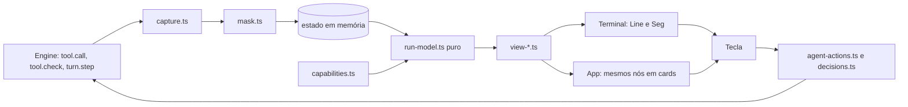

# Arquitetura

Decisão durável: ADR 0001. Base visual: Flows5 ("uma fonte, dois renderizadores").

## Componentes
| Componente | Responsabilidade | Task |
|---|---|---|
| `capabilities.ts` | matriz por superfície, da ADR 0002 | T-001 |
| `run-model.ts` | `buildRunModel`, estado, progresso, ETA | T-002 |
| `capture.ts` | passos, tokens, custo | T-003 |
| `mask.ts` | máscara, falha fechada | T-004 |
| `vocabulary.ts` | estados, tokens, glifos, `KEY_MAP` | T-005 |
| `view-*.ts` | árvore, worktrees, workflow, detalhe, custo, ferramentas | T-006 a T-010 |
| `decisions.ts`, `agent-actions.ts` | envio e confirmação | T-011, T-012 |
| `layout.ts`, `motion.ts` | larguras e quadros | T-013, T-014 |

## Código compartilhado
`monitor.ts` e `compact.ts` têm mais de um chamador, e `register.tsx` os consome em `:447` e `:471`. T-002 mantém reexportações até as telas migrarem, para não quebrar os 12 arquivos de teste. Reexportar é provisório: T-013 remove o que ficar sem chamador.

Guarda com saída: `needs-you` entra em `tool.check` com `ask` e sai quando chega o `tool.call` daquele `tool_use_id`, uma recusa, ou o fim do agente. `Enviando…` sai na resposta do engine ou no fim do agente; sem resposta em 10 s, mostra falha e restaura o estado.

## Segurança
- A01 acesso: o painel só responde ao pedido pendente e àquele `tool_use_id`. Nunca grava regra permanente. Respeita `ceiling` e ferramentas que exigem a pessoa (`index.d.ts:13726`), e nunca responde sem tecla ou clique da pessoa.
- A02 dados: máscara antes do estado. Ordem: mascarar e depois truncar. Sem disco e sem rede. `drawSig` só vê texto mascarado.
- A03 injeção: `$.process` por argv, sem shell; caminho vem de `worktreeOf`, conferido contra `.claude/worktrees` ou a raiz da sessão. Texto de agente é dado, nunca comando; caracteres de controle são removidos antes de desenhar, pois podem falsificar um card ou uma pergunta.
- A04 desenho: máscara é melhor esforço e não garante reconhecer todo segredo. `docs/privacy.md` diz isso.
- A05 configuração: `OFFICE_CAPTURE_IO` aceita só o valor exato `1`.
- A09: nenhum log contém prompt ou comando.
- Copiar (`y`) leva somente o texto mascarado.
- Retry nunca reexecuta sem confirmação e não reenvia prompt mascarado como se fosse o original.

## Desempenho
Orçamento: `buildRunModel` com 60 agentes abaixo de 16 ms, medido por teste. Valor próprio, sem SLA do usuário; confirmar na primeira medição. Sem redraw se a assinatura não mudou. Git: no máximo uma execução a cada 30 s por worktree.

## Observabilidade
Sem telemetria nova. Falhas internas vão para o aviso no próprio painel.

## Banco, API, filas
not applicable — sem banco, sem HTTP e sem filas.
