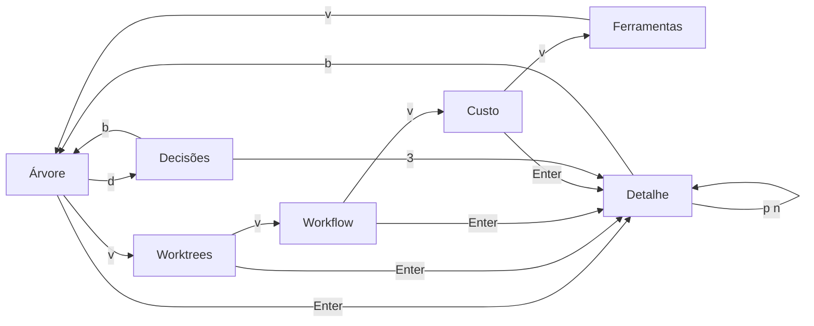

# Interface

Vinculante: canvas Rodada 5. Cópias locais lidas: `Foundations5.dc.html`, `Term5.dc.html`, `Flows5.dc.html`, `Responsive5.dc.html`, `Proto5.dc.html`. AdminLTE, `__()`, `h()`: not applicable — Box/Text/Button da mod.

## Mapa de telas e reuso
| Tela | Tecla ou aba | Reuso | Task |
|---|---|---|---|
| Árvore | `v` | `renderCompact`, modo `tree` | T-006 |
| Worktrees | `v` | modo `grouped` | T-007 |
| Workflow | `v` | novo | T-008 |
| Custo | `v` | modo `waterfall` | T-010 |
| Ferramentas | `v` | novo | T-010 |
| Decisões | `d` | novo | T-011 |
| Detalhe | Enter | `detailLines`, `detailCompact` | T-009 |
| Cards | `g` alterna | modo `cards` | T-013 |
| Mapa | atual | mantido até Unresolved 3 | — |

## Estados (Foundations5)
| Estado | Rótulo | Cor escura | Cor clara | Terminal | ASCII | Quando |
|---|---|---|---|---|---|---|
| `queued` | Na fila | #A9ADB5 | #5A5F68 | ○ | `[ ]` | Criado, sem primeira ferramenta |
| `running` | Rodando | #7FA9FF | #2257C9 | ⠹ | `..` | Ferramenta nos últimos 10 min |
| `needs-you` | Precisa de você | #F2B84B | #8A5A00 | ◆ | `[??]` | Pergunta pendente |
| `stalled` | Parado sem sinal | #F2B84B | #8A5A00 | ▲ | `[!!]` | Mais de 10 min sem atividade, ou quota |
| `paused` | Pausado | #A9ADB5 | #5A5F68 | ‖ | dois traços verticais | Pausa pedida |
| `failed` | Falhou | #FF8A80 | #B3261E | ✗ | `[xx]` | Erro no resultado |
| `done` | Concluído | #6FD08C | #1B7A3D | ✓ | `[ok]` | Sem erro |
| `stopped` | Interrompido | #A9ADB5 | #5A5F68 | ■ | `[--]` | Parado pelo usuário |

Cor clara dos estados neutros vem de `muted`; o canvas só lista a escura para eles. Worktree é marca, não estado: ⧉, `wt:`, cor #BD9BFF. Tokens: `bg` #141517/#F6F7F8, `surface` #1C1E21/#FFFFFF, `line` #303338/#DDE0E4, `text` #ECEEF1/#17191C, `muted` #A9ADB5/#5A5F68. Raio: card 10, botão 8, pílula 999. Espaço: 4, 8, 12, 16, 24. IBM Plex Sans e Mono no app, se a superfície permitir; números tabulares.

## Mapa de teclas único
| Tecla | Ação | Tecla | Ação |
|---|---|---|---|
| `j` `k` | mover | `d` | decidir |
| Enter | abrir | `r` | repetir |
| `b` | voltar (Esc não chega: `actions.ts:35`) | `x` | parar |
| `p` `n` | irmão anterior e próximo | `u` | pausar e retomar (assunção) |
| `v` | visão | `a` | abrir no chat |
| `f` | falhas | `y` | copiar; em confirmação, sim |
| `s` | buscar (`/` é recusada) | `n` | em confirmação, não |
| `g` | colapsados ou todos | `q` | fechar |
| `1` `2` `3` | opções na tela Decisões | | |

## Larguras (Foundations5, Responsive5)
Terminal: 100+ completo; 60 a 99 compacto; abaixo de 60 só lista. App por container: 1, 2, 3, 4 colunas em 0, 520, 780, 1040 px. Detalhe ao lado a partir de 900 px, abaixo cobre a lista. Abaixo de 520 px, linhas de status, nome e tempo; filhos recuados com guia. Nome quebra, nunca corta; encolhe primeiro o `agora`. Card com 3 alturas: compacto, padrão, expandido. Abas em rolagem horizontal, ativa visível. Ações presas ao fim do detalhe. Falha e decisão sempre primeiro. Alvo de toque 44 px no app, se a superfície permitir.

## Movimento (Foundations5)
| Efeito | App | Terminal |
|---|---|---|
| Agente trabalhando | 900 ms linear | Spinner, 6 quadros/s |
| Fluxo pai e filho | 800 ms linear | Ligação colorida, sem animar |
| Novo agente | card 220 ms ease-out | Linha aparece |
| Decisão | ◆ 1600 ms até responder | Sobe ao topo, sino uma vez |
| Foco | demais a 45%, 160 ms | demais em cinza |
| Trocar visão | crossfade 140 ms | troca direta |

Reduzido: nada se move, ponto fixo, 1 quadro/s. Efeito do app que a superfície não suportar vira troca direta (`appMotion`), registrado sem simulação.

## Estados por tela
Vazia: mensagem e teclas válidas. Carregando: não há, o dado chega por evento. Erro: mensagem no card, estado anterior. Sem suporte: controle não aparece. Sucesso: estado vindo do engine.

## Honestidade dos números
Sem % inventado; barra só com total conhecido (`3/5 tarefas`); custo com `~`; `—` sem dado; ETA com no mínimo 3 concluídos do mesmo modelo.
