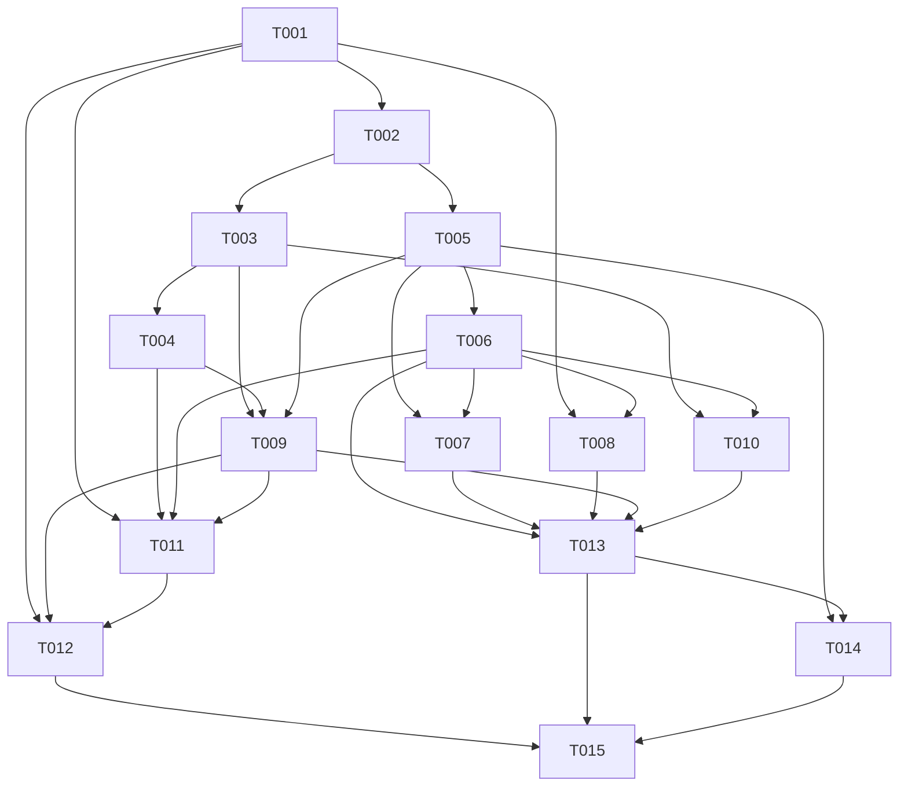

# Tasks — office-agent-monitor-v2

Executor: 🛠️ Pleno · 🎼 Sonnet · 🟢 baixo

Ordem por DAG. T-001 é bloqueante: nenhuma outra task começa antes de sua ADR.

| Task | Título | depends_on | Requisito | Executor |
|---|---|---|---|---|
| T-001 | Spike bloqueante: provar o que o engine expõe e registrar em ADR | — | REQ-001 | 📐 Arquiteto · 🎼 Sonnet · 🟢 baixo |
| T-002 | Extrair o RunModel puro e unificar tipos | T-001 | REQ-002 | 🦉 Senior · 🎼 Sonnet · 🟢 baixo |
| T-003 | Capturar linha do tempo por ferramenta, tokens e custo em memória | T-002 | REQ-003 | 🦉 Senior · 🎼 Sonnet · 🟢 baixo |
| T-004 | Mascarar segredos, opt-in OFFICE_CAPTURE_IO e atualizar privacidade | T-003 | REQ-004 | 🧠 Especialista · 🎼 Sonnet · 🟢 baixo |
| T-005 | Vocabulário de estado, tokens, fallback de glifos e mapa de teclas único | T-002 | REQ-005 | 🛠️ Pleno · 🎼 Sonnet · 🟢 baixo |
| T-006 | Visão Árvore com conectores para agentes e subagentes | T-005 | REQ-006 | 🛠️ Pleno · 🎼 Sonnet · 🟢 baixo |
| T-007 | Visão Worktrees com saúde por branch | T-005, T-006 | REQ-007 | 🦉 Senior · 🎼 Sonnet · 🟢 baixo |
| T-008 | Visão Workflow com fases reais | T-001, T-006 | REQ-008 | 🦉 Senior · 🎼 Sonnet · 🟢 baixo |
| T-009 | Tela de detalhe e fluxo de progresso honesto | T-003, T-004, T-005 | REQ-009 | 🛠️ Pleno · 🎼 Sonnet · 🟢 baixo |
| T-010 | Visões Custo e Ferramentas | T-003, T-006 | REQ-010 | 🛠️ Pleno · 🎼 Sonnet · 🟢 baixo |
| T-011 | Decisões: Precisa de você, Allow e Decline | T-001, T-004, T-006, T-009 | REQ-011 | 🧠 Especialista · 🎼 Sonnet · 🟢 baixo |
| T-012 | Ações: Pause, Stop, Retry e open-in-chat | T-001, T-009, T-011 | REQ-012 | 🧠 Especialista · 🎼 Sonnet · 🟢 baixo |
| T-013 | Regras de layout responsivo | T-006, T-007, T-008, T-009, T-010 | REQ-013 | 🛠️ Pleno · 🎼 Sonnet · 🟢 baixo |
| T-014 | Movimento e movimento reduzido | T-005, T-013 | REQ-014 | 🛠️ Pleno · 🎼 Sonnet · 🟢 baixo |
| T-015 | README, documentação e CI | T-012, T-013, T-014 | REQ-015 | ⚙️ DevOps · 🪶 Haiku · 🟢 baixo |

