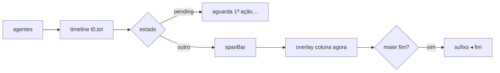

# Spec técnica

Arquivo único tocado no código: `plugins/agent-office/hooks/compact.ts` (`waterfallLines`, l.721) + `video-parity.test.ts`.

- `timeline(g, now)` já dá `t0`, `tot`. Coluna agora = `round((now - t0)/tot * cells)`; sobrescreve a célula daquela coluna em cada linha com `│` (ASCII `|`) DIM, sem apagar barra (barra vence).
- Eixo: linha extra após as linhas dos agentes com `agora` alinhado à coluna.
- Segura o fim: `argmax(fim)` entre agentes visíveis, fim = `endedAt ?? now`; empate = primeiro na ordem. Sufixo `◂ fim` (ASCII `< fim`) cor de atenção. Só se ≥2 agentes.
- Pendente (`state === 'pending'`): no lugar de `spanBar`, `aguarda 1ª ação…` DIM truncado a `cells`.
- Desktop: modo waterfall já cai em texto (register.tsx:876), herda sem código novo.
- Sem I/O, sem dado sensível novo; máscara inalterada.

