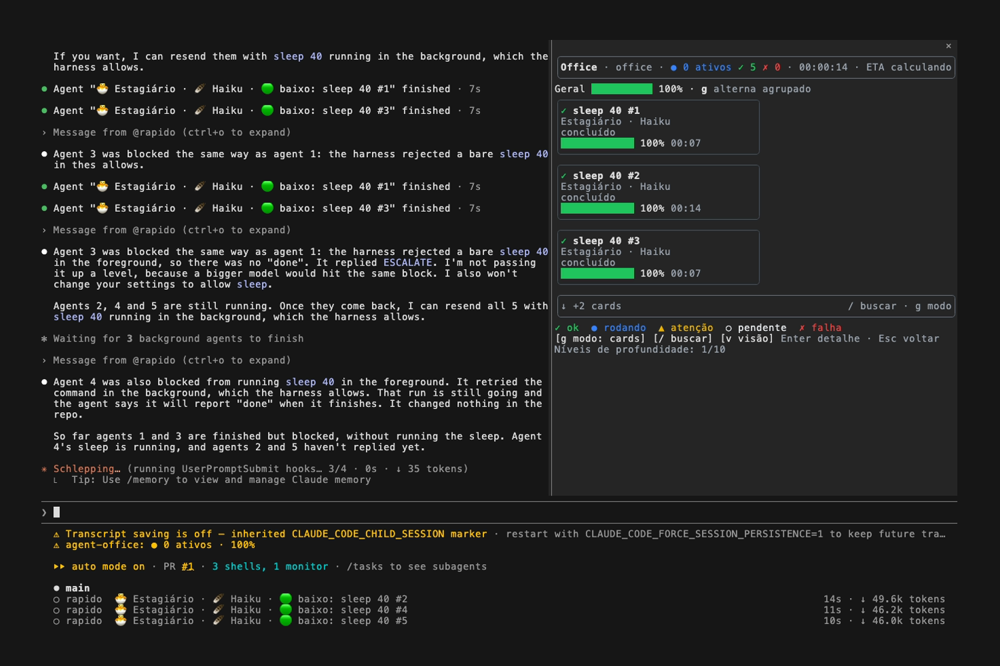
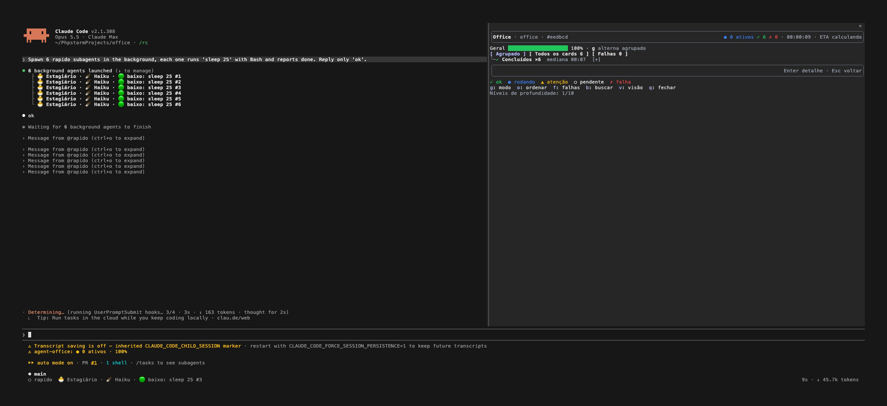
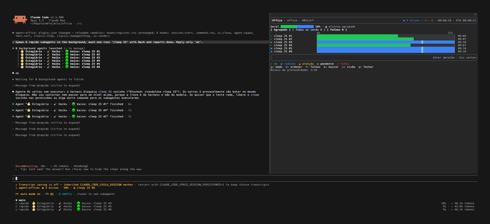
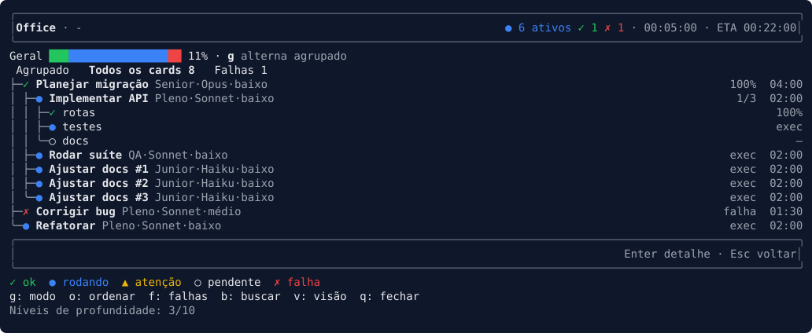
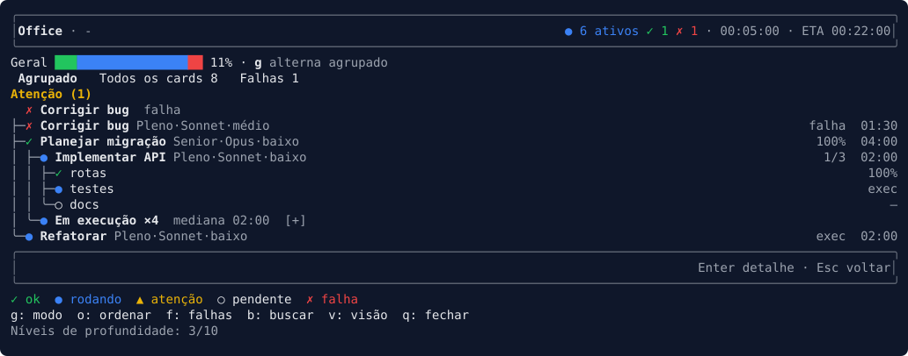
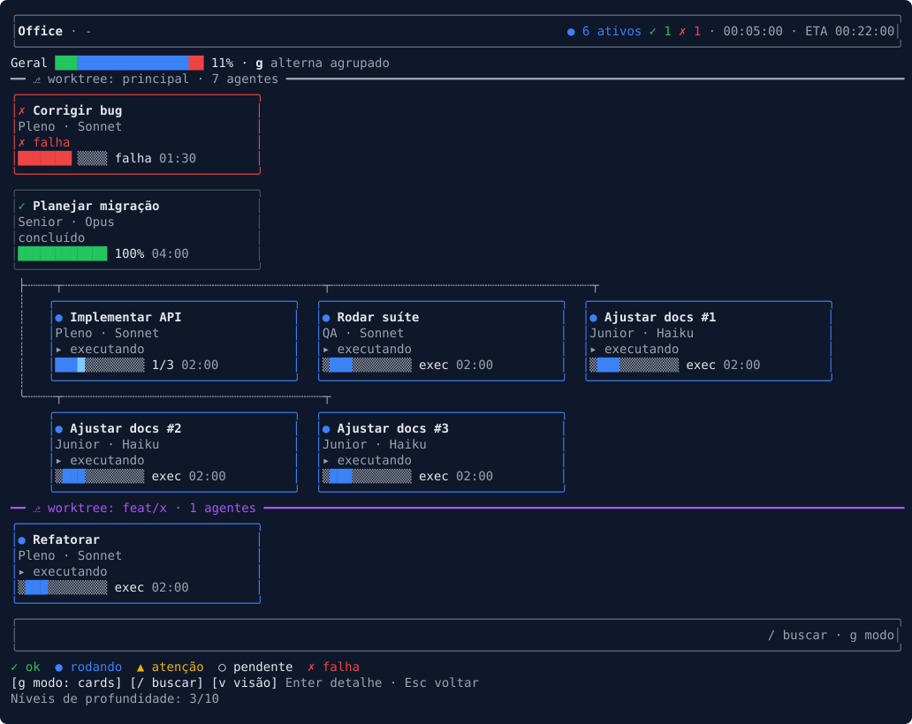
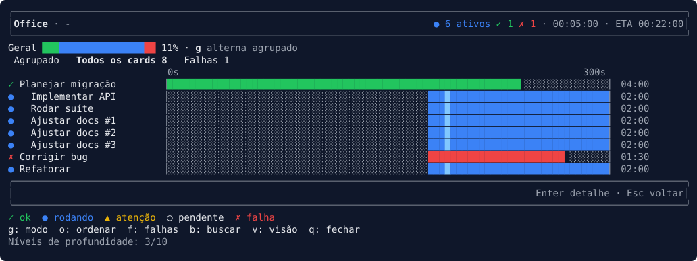
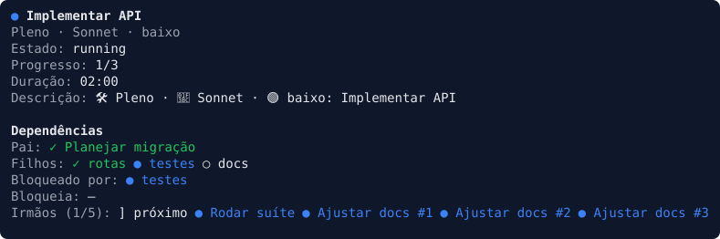
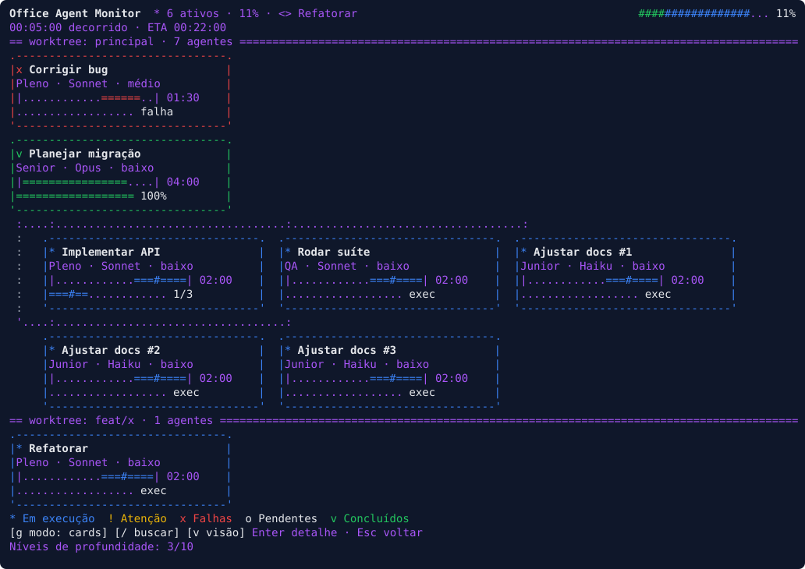

# Claude Code Office

Mod `agent-office` (mapa animado de agentes e subagentes) e partes opcionais: personas/router, aprendizagem, Laya.

## Início rápido (pt-BR)

```bash
npx @lucasnpinheiro/office --scope global      # instala só o agent-office
npx @lucasnpinheiro/office --all --scope local # tudo, só no projeto atual
claude plugin marketplace add lucasnpinheiro/office && claude plugin install agent-office@office   # sem Node
```

Reinicie o Claude Code (ou `/reload-plugins`) e use `/office start`. Cada parte opcional é um plugin separado;
`--dry-run` mostra os comandos sem executar; `--uninstall` remove tudo. Documentação em inglês abaixo e em `docs/`.

---

## What it is

A marketplace with four independent plugins for Claude Code:

| Plugin | What | Needed? |
|---|---|---|
| `agent-office` | `/office`: animated map of agents and subagents (state, progress, ETA, dependencies) | the main one |
| `personas` | `rapido`/`padrao`/`profundo` subagents (Haiku/Sonnet/Opus), 17-persona table, optional tier-router hook | optional |
| `learning` | `task-observer` skill + empty observation log + CLAUDE.md snippet | optional |
| `laya` | MCP wiring + skill for the [Laya](https://github.com/lucasnpinheiro/laya) decision model (not bundled) | optional |

`caveman` (terse replies) is also optional and not bundled (upstream, Apache-2.0): https://github.com/JuliusBrussee/caveman.

## Monitor view (compact redesign)

Real capture (vhs, live Claude Code session with 5 background agents, default cards view):





The three captures are real (vhs, 6 background agents, `OFFICE_MODE=<mode> OFFICE_WIDTH=140`).

The SVGs below come from the real `renderCompact` / `detailCompact` functions with sample agents
(`scripts/render-docs.ts`, monospace SVG). They are **not** screenshots of a live Claude Code terminal:
mods cannot be driven headlessly from here.

| Compact tree | Grouped (siblings by state) |
| --- | --- |
|  |  |

Cards (ungrouped): 34x6 cards, siblings side by side (`per_row = floor((cols - x_parent - 5 + 2) / 36)`, 3 at 120 cols, 5 at 200), dotted bus with a drop per card, heavy worktree divider. Each card carries a span on the session timeline and a progress bar.



Waterfall mode (`/office mode waterfall`): one span per agent on a shared time axis. Running spans have a sub-cell head and a moving shimmer cell; bars grow with an ease-out stagger when a span starts; reduced motion is static. Animated render (SVG, CSS steps, 4 fps):




| Detail (dependencies, attachments) | ASCII mode |
| --- | --- |
|  |  |

Controls. Mods get no raw key events, but a `Button` can carry a `hotkey` (one letter or digit) that fires only while the
monitor pane holds the focus: `/office start` opens it focused; at session start it opens unfocused, so press ctrl+x tab
(or click it) first. Every key below is drawn in the footer of the view it works in, unique per view, and all hotkeys are
off while the search field is open (Enter applies the search, empty clears it). Since 0.15.0 the session always starts in
the ungrouped cards view (a stale mode or open search left by an older version is reset).

| View | Keys |
| --- | --- |
| Cards / tree / grouped / waterfall | `g` mode, `o` sort, `f` only failures, `s` search, `v` map view, `q` close |
| Detail (narrow pane) | `b` back, `p`/`n` previous/next sibling, `q` close |
| Detail in the side panel (150+ cols) | list keys above plus `b` back |
| Attachment preview | `b` close preview, `q` close |
| Map view | `v` back to cards, `b` back (detail open), `q` close |
| Search field open | none (typing goes to the field) |

Not possible for mods: `/` as a key (hotkeys are letters/digits only; Esc never reaches a mod), `o` open-externally and kitty/sixel images.

Commands: `/office mode tree|grouped|cards|waterfall`, `/office sort time|state|name`, `/office filter failed|all`,
`/office search <text>`, `/office open <id>`, `/office view map|compact`, `/office width <cols>`
(a request: a docked pane is capped at 45% of the terminal). Env at start: `OFFICE_MODE`, `OFFICE_WIDTH`.

Card details: a leaf shows a real percent only from its own TodoWrite progress (`done/total`), otherwise an indeterminate
sweep; an agent that has not made its first tool call yet is pending (`aguarda 1ª ação`); each worktree divider carries
a structure and status summary.

Credits: the waterfall idea (spans on a time axis, staggered reveal, shimmer on running spans) was inspired by the
public page of the "Trace waterfall" component at https://kobra.systems/components/trace-waterfall. That component is a paid, proprietary product
(its public page shows no keyframes or license text), so nothing from it was copied: the effect here is re-implemented from scratch with block characters.

Environment: `OFFICE_ASCII=1` (force ASCII), `NO_COLOR` (mono), `OFFICE_REDUCED_MOTION=1` (also `CI`, non-TTY: 1 fps).
Auto: ASCII for `TERM=linux|dumb`, non-UTF-8 locale or legacy Windows conhost; colors truecolor, 256, 16, mono.

## Install

```bash
npx @lucasnpinheiro/office [--with-personas] [--with-learning] [--with-laya] [--with-caveman] [--all] \
  [--scope global|local] [--dry-run] [--uninstall]
```

Or with the plain CLI:

```bash
claude plugin marketplace add lucasnpinheiro/office
claude plugin install agent-office@office
claude plugin install personas@office learning@office laya@office   # one command per plugin; each optional
```

Or inside a session: `/plugin install agent-office --marketplace lucasnpinheiro/office`.

`--scope global` writes to your user settings, `--scope local` to the current project. Without the flag the installer
asks (interactive) or uses global.

Installing `personas` is the opt-in for the router hook: it adds a `[model-router]` suggestion to each prompt (Laya
if reachable, otherwise a keyword floor, default `padrao`). No hint means your session chooses the tier itself.

## Optional parts

- **Laya**: `git clone https://github.com/lucasnpinheiro/laya "$HOME/laya"`, `export LAYA_HOME="$HOME/laya"`,
  `docker compose up -d` inside it, install `uv`. The router and the MCP both work without it.
- **Learning**: `--with-learning` creates `~/.claude/skill-observations/log.md` if missing and prints the CLAUDE.md
  block to paste. Your CLAUDE.md is never edited.
- **caveman**: follow its upstream instructions.

## Uninstall

`npx @lucasnpinheiro/office --uninstall` (or `claude plugin uninstall <name>@office` and
`claude plugin marketplace remove office`). Your data under `~/.claude/skill-observations` and `~/.claude/model-router` is kept.

## Privacy and security

The mod only reads session events. The router hook reads each prompt, logs a 160-character excerpt locally
(`MODEL_ROUTER_LOG=off` disables) and posts to `LAYA_API_URL` only if you run Laya. Details: [docs/privacy.md](docs/privacy.md).
More: [getting started](docs/getting-started.md), [architecture](docs/architecture.md), [troubleshooting](docs/troubleshooting.md).

## Development

```bash
npm run validate     # claude plugin validate on the marketplace and each plugin
npm test             # claude plugin test plugins/agent-office
bash scripts/check-sanitized.sh
```

## License

MIT. `plugins/learning/skills/task-observer` is by Eoghan Henn ([rebelytics.com](https://rebelytics.com)), CC BY 4.0,
original: https://github.com/rebelytics/one-skill-to-rule-them-all
