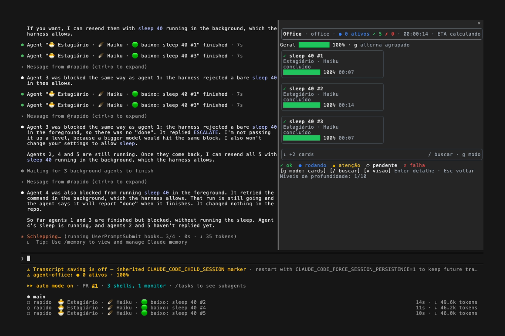
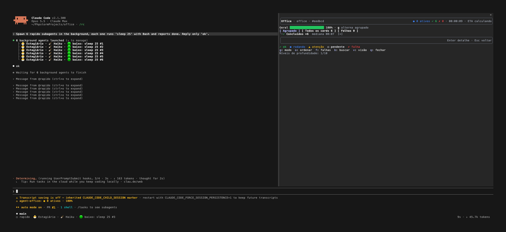
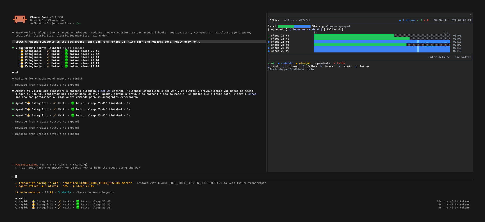
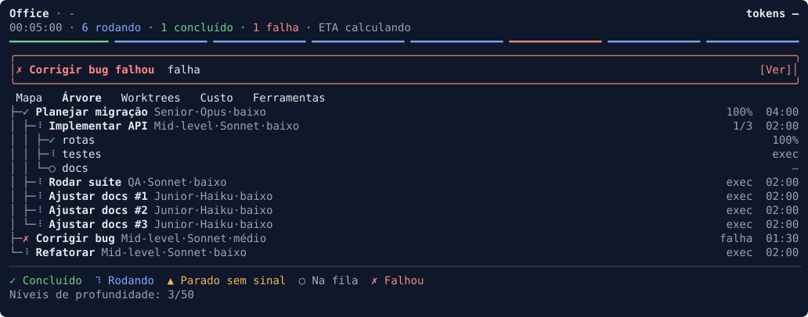
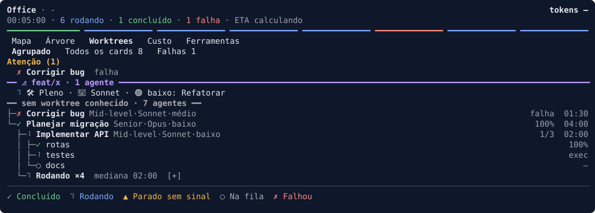
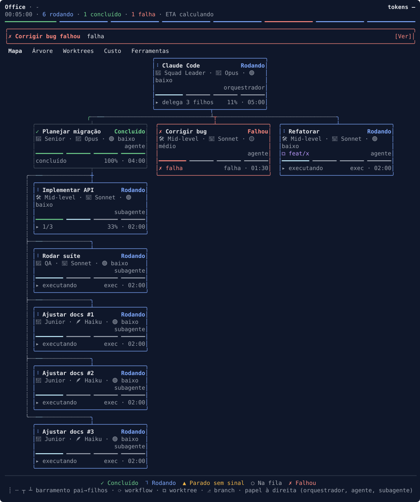
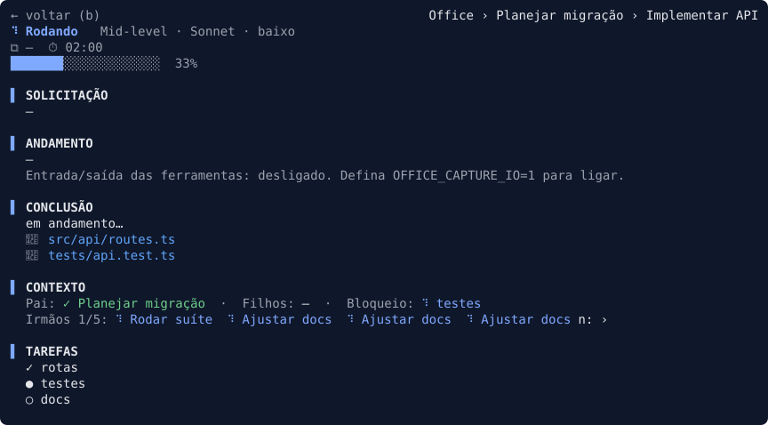
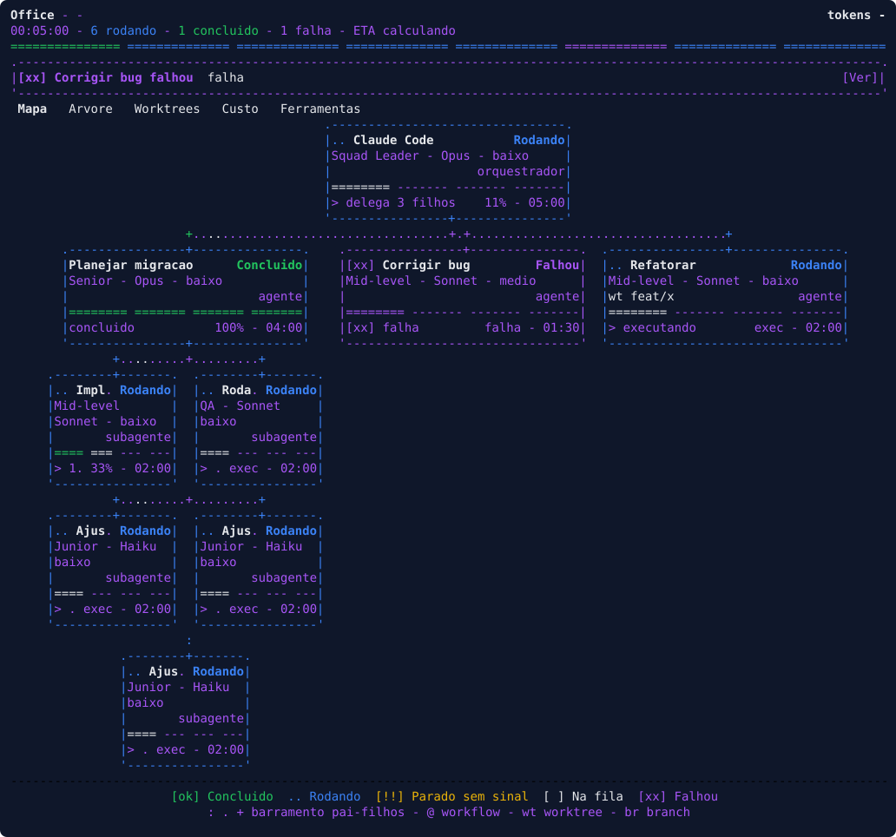
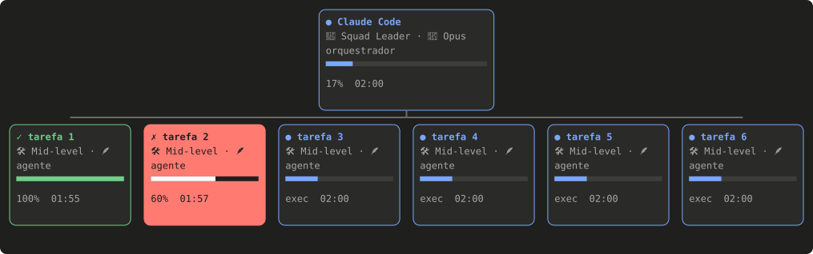
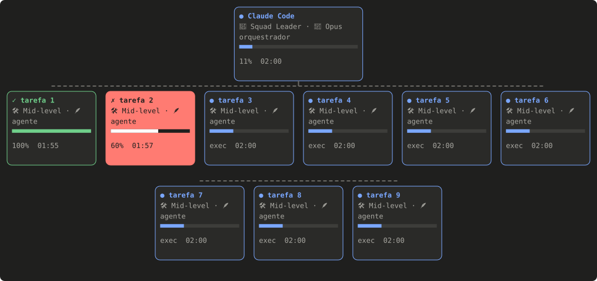

# Claude Code Office

A Claude Code plugin marketplace (`office`) with four independent plugins. The main one, `agent-office`, is a mod
that opens a pane beside the chat and maps the session's agents and subagents live. The other three are optional.

| Plugin | What it does | Needed? | README |
|---|---|---|---|
| `agent-office` | `/office`: animated map of agents and subagents (state, progress, ETA, dependencies, worktrees) | the main one | [plugins/agent-office](plugins/agent-office/README.md) |
| `personas` | `rapido`/`padrao`/`profundo` subagents (Haiku/Sonnet/Opus), 17-persona table, optional tier-router hook | optional | [plugins/personas](plugins/personas/README.md) |
| `learning` | `task-observer` skill, empty observation log, CLAUDE.md snippet | optional | [plugins/learning](plugins/learning/README.md) |
| `laya` | MCP wiring and skill for the [Laya](https://github.com/lucasnpinheiro/laya) decision model (Laya not bundled) | optional | [plugins/laya](plugins/laya/README.md) |

`caveman` (terse replies) is a separate upstream project, not bundled (Apache-2.0): https://github.com/JuliusBrussee/caveman.

## Install

With the Claude Code CLI (one plugin per `install` command):

```bash
claude plugin marketplace add lucasnpinheiro/office
claude plugin install agent-office@office
claude plugin install personas@office    # optional
claude plugin install learning@office    # optional
claude plugin install laya@office        # optional
```

One command per plugin that adds the marketplace when it is missing:

```bash
claude plugin install agent-office --marketplace lucasnpinheiro/office
```

Inside a session: `/plugin marketplace add lucasnpinheiro/office`, then `/plugin install agent-office@office`.
`--scope user|project|local` picks the settings file (default `user`).

Or the installer, run straight from GitHub (Node 18+; the npm package is not published yet):

```bash
npx github:lucasnpinheiro/office --scope global             # marketplace + agent-office
npx github:lucasnpinheiro/office --all --scope local        # everything, this project only
npx github:lucasnpinheiro/office --dry-run --all            # print the commands, run nothing
```

Installer flags: `--with-personas`, `--with-learning`, `--with-laya`, `--with-caveman` (pointer only), `--all`,
`--scope global|local` (`global` = `~/.claude/settings.json`, `local` = this project's `.claude/settings.json`;
`user`, `project` and `local-private` are accepted too), `--local-source` (install from this clone), `--dry-run`,
`--uninstall`. Unknown flags are rejected. Re-running it is safe: an already-added marketplace is refreshed.

After installing, restart Claude Code or run `/reload-plugins`. The monitor opens by itself at session start.

## Update

A new version reaches you only after the marketplace catalog is refreshed:

```bash
claude plugin marketplace update office       # re-read the catalog from GitHub
claude plugin update agent-office@office      # repeat for each installed plugin
```

Then restart Claude Code (or `/reload-plugins`). `claude plugin list` shows the installed version.

## Uninstall

```bash
claude plugin uninstall agent-office@office   # repeat per plugin
claude plugin marketplace remove office
```

Or `npx github:lucasnpinheiro/office --uninstall --scope global`. Your data under `~/.claude/skill-observations` and
`~/.claude/model-router` is kept.

## Local development

```bash
git clone https://github.com/lucasnpinheiro/office && cd office
claude --plugin-dir ./plugins/agent-office                # one session, loaded from disk, edits hot-reload
claude plugin marketplace add ./                          # or: a folder marketplace, read in place
claude plugin install agent-office@office                 # /reload-plugins picks up edits, no version bump
claude plugin validate --strict .                         # marketplace manifest
claude plugin validate --strict plugins/personas          # each plugin (also learning, laya, agent-office)
claude plugin test plugins/agent-office                   # mod tests
bash scripts/check-sanitized.sh
```

## agent-office: the monitor

### Views and modes

- **Map** (default at session start): mind map of the session, its agents and their TodoWrite tasks.
- **Compact** (`v` from the map): one of four modes, cycled with `g` or set with `/office mode`:
  `cards` (default), `tree`, `grouped` (siblings collapsed by state; with worktrees, each worktree is a divider with its agents nested under it), `waterfall` (spans on a shared time axis), `cost` (tokens and time per agent; `~$` stays `—` per agent, the session USD shows only when the engine gives it), `tools` (calls per tool) and `workflow` (agents grouped by workflow run id; phases are not available from the engine; `g` stops there only while a run exists).
- **Detail**: Enter (or a click) on a card; `b` goes back. On a pane 150+ columns wide (110+ in the desktop app) it
  opens as a side panel next to the cards.

Real captures (vhs, live Claude Code session with background agents, `OFFICE_MODE=<mode> OFFICE_WIDTH=140`):





The images below are **renders, not screenshots**: SVGs drawn by the real `renderCompact` / `detailCompact` functions
with sample agents (`scripts/render-docs.ts`).

| Render: compact tree | Render: grouped |
| --- | --- |
|  |  |

| Render: cards | Render: waterfall (animated) |
| --- | --- |
|  |  |

| Render: detail | Render: ASCII mode |
| --- | --- |
|  |  |

### Views (0.28.x)

### Mapa (default on the app surfaces)

The session is the root card (`🧭 Squad Leader · 👑 Opus · 🟢 baixo`, branch of the session cwd on the left, `orquestrador` on the
right). Root rule from the design legend: with **one** top-level agent the card is titled **Orquestrador**; with **two or more**
top-level agents the root card is titled **Claude Code** and the agents hang below it (solid bus when they fit one row, dashed
rows otherwise). Subagents do not count toward the rule.

- **Depth grows downward.** The level-1 agents sit in one row under the root, joined by a solid bus. Each agent's subagents
  hang directly below that parent, in the parent's column, joined by a short vertical line (a parent never shares a row with its
  children).
- **Many siblings.** When the level-1 agents do not fit one row they wrap into rows of `floor((width - 2 + 2) / 36)` cards
  (cards are 34 wide plus a gap of 2; 3 per row at 112 columns). A dashed trunk on the left links the rows; each row has its own
  dashed bus above it with a short drop into every card. When they all fit in one row the bus is solid. A pane narrower than one
  card shows one card per row; no card is ever dropped.
- **Motion.** The running glyph spins, the bar sweeps, and a lit dash runs along the dashed path that leads to a running agent
  (static with `OFFICE_REDUCED_MOTION=1`).
- Card anatomy: bold title (wraps to 2 lines) with a status pill, `persona · model · effort`, branch or worktree (purple, can
  wrap) with the role on the right (`orquestrador`, `agente`, `subagente`), a segmented progress bar, and a footer with the last
  tool, `~$cost` and `mm:ss`.

#### Cards (flat grid)

Mode `cards` (terminal and app) lays every card in rows by pane width (the same `floor((width - 2 + 2) / 36)` rule), rows stacked
top to bottom, so cards fill the pane horizontally and vertically instead of running off in one row. On the terminal mode `map` (default) is the centred tree described above.

#### Detail (Enter on a card)

```
← voltar (b)                         Office › fns-misc.js
✓ Concluído   Mid-level · Haiku · médio
⧉ fix/office-map-wrap  ⏱ 00:08  31k tok  ~$0,02
████████████████████ 100%

▌ SOLICITAÇÃO
  summary of the prompt (boilerplate and Dir: lines stripped, 3 lines max)
▌ ANDAMENTO                                    3 passos · 8s
  00:03 ✓ Bash  cat CONTRACT.md                            1s
  Entrada/saída das ferramentas: desligado. Defina OFFICE_CAPTURE_IO=1 para ligar.
▌ CONCLUSÃO
  error, final report or "em andamento…"; 📎 attachments shortened (middle ellipsis)
▌ CONTEXTO
  Pai: sessão  ·  Filhos: —  ·  Bloqueio: —
  Irmãos 9/12: ‹ ✓ Engine  ✓ Testes  ✓ UI ›
```

Tokens read `31k tok`; cost is hidden while unknown; the tool name appears once per step; every line is cut to the pane width
(never wrapped mid-word or mid-path). `← voltar (b)` is clickable. The final report in CONCLUSÃO comes from the agent record's
`report` field when present (the engine does not store the handback text today, so a finished agent shows `concluído`).

#### Footer and keys

Three centred rows: the status legend, the glyph legend, then the keys, grouped as filtros (`g o f s`) | visão (`v`) | sair
(`b q`) with the navigation hints last (`j: descer`, `k: subir`, `Tab`, `Enter`, `ctrl+x tab`). Key letters are buttons, the
hints are dim. Rows wrap by width one whole item at a time, so a lone `x:` never appears. In a detail the footer reads
`b: voltar · p/n irmão · j: rolar ↓ · k: rolar ↑ · q: fechar`. `j` / `k` are the `scrollDown` / `scrollUp` actions: in the cards
view they move the window one card block at a time; in a detail they scroll the body 3 lines per press (clamped, reset when a
detail opens or closes).

#### Statuses

| Status | Glyph | Color (dark) |
|---|---|---|
| Rodando | `⠹` spinner | blue `#7FA9FF` |
| Concluído | `✓` | green `#6FD08C` |
| Falhou | `✗` | red `#FF8A80` |
| Precisa de você / Parado sem sinal | `◆` / `▲` | amber `#F2B84B` |
| Na fila / Pausado / Interrompido | `○` / `‖` / `■` | grey `#A9ADB5` |

State is always carried by glyph and label as well as color.

#### Finished cards leave after 30 seconds

A **Concluído** card disappears 30 s after the agent ends (all views). **Falhou** and **Precisa de você** cards are never removed
automatically. A finished parent stays while any child is still shown, and leaves 30 s after its last child leaves, so the
tree never has orphans. The header counters (`concluídos`) keep counting every finished agent.

#### Keeping the install current

`scripts/update-installed-plugins.sh` (repo root) refreshes the marketplace and the user-scope install of every plugin whose
`plugin.json` version differs from the installed one; it is idempotent and silent when `claude` is missing. A `post-merge` hook
runs it after a pull or merge that touches a manifest. Enable the hook once per clone:

```bash
git config core.hooksPath .githooks
```

Self-check: `bash scripts/test-update-installed.sh`. **Restart Claude Code after an update** (or run `/reload-plugins`): the
running session keeps the old code until then.


### App Mapa (0.28.13): cards shrink with the sibling count, up to 6 side by side

Rendered from the real `appMap` + `appCardW`/`mapRows` layout by `scripts/render-docs.ts` (schematic SVG of the app cell grid, not a screenshot).

| 6 agents, one row | 9 agents, 6 + 3 |
|---|---|
|  |  |

#### Changelog summary

- **0.28.8**: card view on app surfaces lays out in explicit rows by pane width (flex wrap did not wrap, so all cards sat in one row).
- **0.28.9**: map wrap rule (`mapRows`: solid vs dashed bus, rows by width) and root rule covered by tests; footer regrouped,
  centred and wrapped, `j`/`k` are visible items (they rendered as empty `j:` / `k:` lines); the installed-plugin updater and hook.
- **0.28.10**: Concluído cards expire after 30 s; detail view redesigned (Solicitação / Andamento / Conclusão / Contexto).
- **0.28.18**: video parity. 8 tabs in one order on terminal and app (Mapa, Árvore, Worktrees, Cards, Waterfall, Custo, Ferramentas, Workflow; Workflow dimmed with no run). **Breaking:** terminal mode `map` is now the default and is the centred org chart with bus (what `cards` was); `cards` is a new plain grid of every agent card; a persisted or scripted `/office mode cards` or `OFFICE_MODE=cards` now shows the grid. Grouped with no worktrees: one divider per state (`Rodando ×N`, failures first). Attention pill reads `Atenção` (was `Aguarda você`). `/office mode <unknown>` keeps the mode and lists the 8.
- **0.28.17**: header shows plan limits (`5h N% · reinicia em Xh Ym`, `Semana N% · reinicia em Xd Yh`, per-model weekly when present) on an extra dim line, only when `$.session.usage()` exposes them; absent or invalid data hides the segment (never zero). Elapsed stays since the 1st agent. Field names are unverified against the engine.
- **0.28.16**: terminal map parent line runs through a central gap in row 1 to later rows; price table on current Opus/Sonnet/Haiku 5.5 rates.
- **0.28.15**: estimated per-agent cost (`~$`, tokens x model price table); long card titles wrap to a second line beside the fixed pill.
- **0.28.14**: map nests every parent's children in rows of up to 6 (card 18..34 cols, columns drop before data is cut, depth 10 then "+N ocultos"); j/k scroll the map; state pill on every card replaces ✓; chips never split; legend "j: desce"/"k: sobe"; single "[← voltar]" in the detail view.
- **0.28.13**: app map cards shrink with the sibling count (26 down to 15 cols) so up to 6 sit side by side before wrapping (was 3-4); card content unchanged. The app surface is a cell grid, so width is the scale lever (no font-size control).
- **0.28.12**: app cards 25% smaller (26 cols, was 34; no inner padding); the running line segment blinks, waiting (Na fila / Aguarda você) is white, a failed card takes the red line color as its background.
- **0.28.11**: root rule from the design legend (Orquestrador over one top agent, Claude Code over two or more); `j`/`k` scroll the detail body, with `j: rolar ↓` / `k: rolar ↑` in the detail footer.

Full history: [CHANGELOG.md](CHANGELOG.md).

### Layout, breakpoints and scrolling

Follows the Claude Design board "Office Agent Monitor Redesign" (Rodada 5). The pane height is the terminal height (no fixed
cap) and the layout is recomputed on every resize.

| Pane width | Layout |
| --- | --- |
| 100+ columns | full cards, centred tree, status pill, chips, step bar |
| 60 to 99 | compact cards, the "agora" (current tool) shrinks first, cost and time stay |
| under 60 | list only: failures and decisions first, then rows of status, name and time with indented children |
| 150+ (110+ in the desktop app) | detail opens as a side panel; below that it covers the list |

- Overflowing cards scroll: a vertical scrollbar (`░` track, `█` thumb; `|` and `#` in ASCII mode) sits on the last column,
  cards re-wrap one column narrower to make room, and a stale scroll offset is clamped after a resize.
- Tabs that do not fit scroll horizontally (a leading `‹`) so the active one stays visible.
- Every card is shown, always open, by default: nothing is hidden to fit. Overflow is handled by the scroll and the scrollbar. Collapsing identical siblings (`Rodando xN`) is opt-in: in the tree, `g` folds them, the next `g` moves to the next mode.
- Keys: `j` scroll down, `k` scroll up (one card row per press, shown in the footer), plus the hotkeys below.

### Hotkeys

Mods get no raw key events: each key is a button hotkey that fires only while the monitor pane holds the focus.
`/office start` opens it focused; at session start it opens unfocused, so press **ctrl+x tab** (or click the pane)
first. Every view draws its own keys in its footer. While the search field is open no hotkey fires (Enter applies the
search, empty clears it).

| View | Keys |
| --- | --- |
| Map | `v` to compact, `b` back (detail open), `q` close |
| Compact (cards / tree / grouped / waterfall / cost / tools / workflow) | `j` / `k` scroll, `g` mode, `o` sort, `f` only failures, `s` search, `v` to map, `q` close |
| Detail (narrow pane) | `b` back, `p` / `n` previous / next sibling, `q` close |
| Detail as side panel | the compact keys plus `b` back |
| Attachment preview | `b` close preview, `q` close |
| Search field open | none (typing goes to the field) |

Not possible for a mod: `/` or Esc as keys, opening files externally, kitty/sixel images.

### Commands

`/office` (toggle), `/office start | stop`, `/office view [map|compact]` (no value toggles),
`/office mode map|tree|grouped|cards|waterfall|cost|tools|workflow`, `/office sort time|state|name`, `/office filter failed|all`,
`/office search <text>` (empty clears), `/office open <id>`, `/office width <cols>` (a request: a docked pane is capped
at about 45% of the terminal), `/office collapse | expand`, `/office status`, `/office reset` (monitor closed),
`/office help`. Subcommands are case-insensitive.

### Environment

| Variable | Effect |
| --- | --- |
| `OFFICE_VIEW` | app surfaces only (desktop, vscode, mobile): `map` (default) or `compact`. The terminal has one view, the centred cards |
| `OFFICE_MODE` | `cards` (default), `tree`, `grouped`, `waterfall`, `cost`, `tools`, `workflow` |
| `OFFICE_WIDTH` | requested pane width in columns |
| `OFFICE_ASCII=1` | ASCII glyphs (also automatic for `TERM=linux\|dumb`, non-UTF-8 locales, legacy Windows conhost) |
| `NO_COLOR` | monochrome (otherwise truecolor, 256 or 16 colors, detected) |
| `OFFICE_REDUCED_MOTION=1` | no animation, 1 fps clocks (also under `CI`) |
| `AGENT_OFFICE_THUMBS=1` | opt-in browser-MCP thumbnails, kept in memory only |

A new session always starts from the map with the default mode, sort, filter and width; a previous session's search,
filter or open detail never carries over.

### Card details

A leaf shows a real percent only from its own TodoWrite progress (`done/total`), otherwise an indeterminate sweep; an
agent that has not made its first tool call is pending (`aguarda 1ª ação`). Quota and rate-limit failures show as
attention, not as failures. Each worktree divider carries a structure and status summary. Wide glyphs (CJK, emoji) are
measured in terminal cells, so cards keep their borders.

Credits: the waterfall idea (spans on a time axis, staggered reveal, shimmer) was inspired by the public page of the
"Trace waterfall" component at https://kobra.systems/components/trace-waterfall, a paid proprietary product. Nothing
was copied; the effect is re-implemented from scratch with block characters.

## Optional parts

- **personas**: installing it opts in to the router hook (one `[model-router]` suggestion per prompt; Laya if
  reachable, otherwise a keyword floor). `claude plugin disable personas@office` turns it off.
- **learning**: `--with-learning` creates `~/.claude/skill-observations/log.md` if missing and prints the CLAUDE.md
  block to paste. Your CLAUDE.md is never edited.
- **laya**: clone Laya, `export LAYA_HOME=...`, `docker compose up -d` in it, install `uv`. Without them the MCP exits at
  once with a message saying what is missing; the router still works without Laya.

## Troubleshooting

- **Still on the old version after an update**: the catalog was not refreshed or the session still runs the old copy.
  Run `claude plugin marketplace update office`, then `claude plugin update <plugin>@office`, then restart Claude Code.
  `claude plugin list` shows the installed version; installed copies live under `~/.claude/plugins/cache/`. A plugin
  only updates when its `version` in `plugin.json` changes.
- **Hotkeys do nothing**: the pane does not have the focus. Press ctrl+x tab (or click it), or open it with
  `/office start`. No key fires while the search field is open.
- **`/office` does nothing**: run `/reload-plugins`, check `claude plugin list` shows `agent-office@office` enabled, and
  `claude plugin validate plugins/agent-office` from a clone.
- **No `[model-router]` line**: `personas` is not installed or is disabled. Test the hook:
  `echo '{"prompt":"fix a typo"}' | bash plugins/personas/hooks/model-router.sh`. It needs Python 3 (`python3` or `python`).
- **Router always says `padrao` ("Laya unavailable")**: Laya is not reachable at `LAYA_API_URL`; that is the fallback.
- **`laya` MCP shows as failed**: see its message in `/mcp` or `claude --debug`: `LAYA_HOME` unset, wrong checkout, or
  `uv` missing.
- **Agent type not found (`personas:padrao`)**: the plugin is not enabled in the current scope (user vs project).

More: [getting started](docs/getting-started.md), [architecture](docs/architecture.md),
[troubleshooting](docs/troubleshooting.md), [privacy](docs/privacy.md).

## Privacy and security

The mod only reads session events; browser thumbnails are opt-in and never stored. The router hook reads each prompt,
logs a 160-character excerpt locally (`MODEL_ROUTER_LOG=off` disables) and posts to `LAYA_API_URL` only if you run Laya.
Details: [docs/privacy.md](docs/privacy.md).

## License

MIT (each plugin carries its own `LICENSE`). Exception: `plugins/learning/skills/task-observer` is by Eoghan Henn
([rebelytics.com](https://rebelytics.com)), licensed CC BY 4.0, original
https://github.com/rebelytics/one-skill-to-rule-them-all (see the NOTICE in [plugins/learning](plugins/learning/README.md)).
