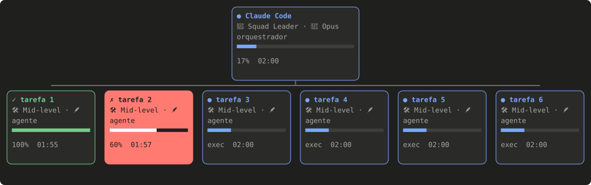
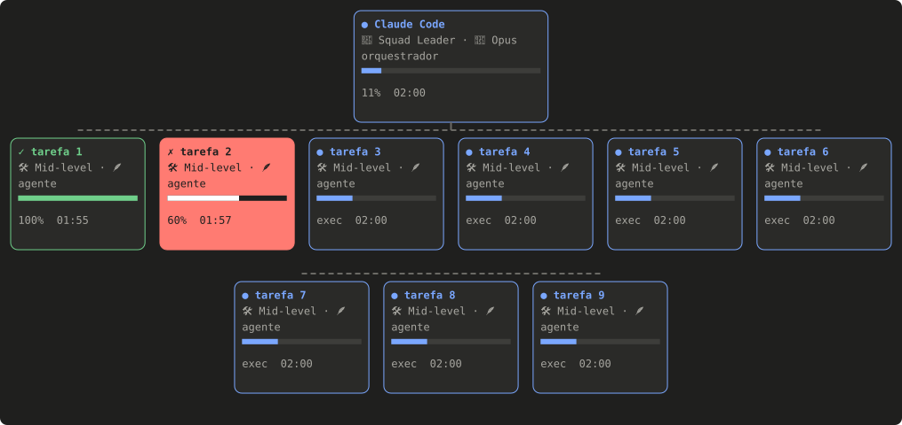

# agent-office

Office Agent Monitor for Claude Code: a pane beside the chat that maps the session's agents and subagents
(state, progress, ETA, dependencies, worktrees) and animates while they run. It is a mod (a hooks module run by the
engine), part of the [`office`](https://github.com/lucasnpinheiro/office) marketplace.

## Install

```bash
claude plugin marketplace add lucasnpinheiro/office
claude plugin install agent-office@office
```

One command, adding the marketplace if it is missing:

```bash
claude plugin install agent-office --marketplace lucasnpinheiro/office
```

Inside a session: `/plugin marketplace add lucasnpinheiro/office`, then `/plugin install agent-office@office`.
Then restart Claude Code or run `/reload-plugins`. The pane opens by itself at session start; `/office start` opens it focused.

## Update and uninstall

```bash
claude plugin marketplace update office      # refresh the catalog first, or the new version is not seen
claude plugin update agent-office@office     # then restart Claude Code (or /reload-plugins)
claude plugin uninstall agent-office@office
```

## What ships

Terminal pane (a mod run by the engine). Views: map (default), tree, grouped, cards (grid), waterfall, cost, tools, workflow (only while a
workflow run exists), worktrees, detail per agent. Per-agent tokens and tool timeline, session token total (marked `parcial` when
something is unknown), `+N commits` per worktree, ETA, masked prompts and errors, responsive layout, spinner at 6 frames/s.

#### Layout, breakpoints and scrolling

Follows the Claude Design board "Office Agent Monitor Redesign" (Rodada 5). The pane height is the terminal height (no fixed
cap) and the layout is recomputed on every resize.

| Pane width | Layout |
| --- | --- |
| 100+ columns | full cards, centred org-chart tree (`┬ ┴ ┄` bus), status pill, chips, step bar, `⟳` workflow badge |
| 60 to 99 | compact cards, the "agora" (current tool) shrinks first, cost and time stay |
| under 60 | list only: failures and decisions first, then rows of status, name and time with indented children |
| 150+ (110+ in the desktop app) | detail opens as a side panel; below that it covers the list |

- Overflowing cards scroll: a vertical scrollbar (`░` track, `█` thumb; `|` and `#` in ASCII mode) sits on the last column,
  the cards are drawn one column narrower to make room, and a stale scroll offset is clamped after a resize.
- Cards tree (design TELA 8): each parent card is centred over its children, the block is centred in the pane, a dotted
  bus `┄` joins them (`┬` under the parent, `┴` over each child) and pulses while a child runs (static in reduced motion).
  Cards always keep the full 7-row anatomy; a short pane scrolls by card row. A card of a workflow run shows `⟳ <runId>` in rose (`#FF8FB1`).
- Tabs that do not fit scroll horizontally (a leading `‹`) so the active one stays visible.
- Every card is shown, always open, by default: nothing is hidden to fit. Overflow is handled by the scroll and the scrollbar. Collapsing identical siblings (`Rodando xN`) is opt-in: in the tree, `g` folds them, the next `g` moves to the next mode.
- Scrolling: the engine exposes no mouse-wheel event, so `j`/`k` scroll (shown in the footer as `j: descer`, `k: subir`); the position shows as `n/total` with `↑`/`↓`. Cards show persona, model and effort as text like the design (`🧭 Squad Leader · 👑 Opus · 🟢 baixo`; models 🪶 Haiku, 🎼 Sonnet, 👑 Opus; effort 🟢 baixo, 🟡 médio, 🔴 alto), wrapping to a second row when too long, and the role (`orquestrador`, `agente`, `subagente`) on the branch row.

Not shipped: Allow, Decline, Stop, Retry, Pause and open-in-chat controls, and the "needs you" (`◆`) decision state. They stay
hidden until the manual probes listed in ADR 0002 are run (see `.specs/features/office-agent-monitor-v2/spec/06-gaps.md`).
No bell is rung (there is no pending-decision state). Per-agent cost is `—` (no price table); workflow phase names, rounds and
totals are unavailable (the engine gives only `runId` and `agentIndex`), so the view groups by run and says "Fases: indisponíveis".

Terminal only. Not verified in the Claude app: width, 44 px targets, motion, reduced-motion signal and any app surface were never
executed there, and no parity is claimed. The 93% coverage target is not measurable with `claude plugin test` (no coverage option).

## Views (0.28.x)

### Mapa (default on the app surfaces)

The session is the root card (`🧭 Squad Leader · 👑 Opus · 🟢 baixo`, branch of the session cwd on the left, `orquestrador` on the
right). Root rule from the design legend: with **one** top-level agent the card is titled **Orquestrador**; with **two or more**
top-level agents the root card is titled **Claude Code** and the agents hang below it (solid bus when they fit one row, dashed
rows otherwise). Subagents do not count toward the rule.

- **Depth grows downward.** The level-1 agents sit in one row under the root, joined by a solid bus. Each agent's subagents
  hang directly below that parent, in the parent's column, joined by a short vertical line (a parent never shares a row with its
  children).
- **Many siblings.** When the level-1 agents do not fit one row they wrap into rows of `floor((width - 2 + 2) / 36)` cards
  (cards are 34 wide plus a gap of 2; 3 per row at 112 columns). A dashed trunk on the left links the rows; each row has its own
  dashed bus above it with a short drop into every card. When they all fit in one row the bus is solid. A pane narrower than one
  card shows one card per row; no card is ever dropped.
- **Motion.** The running glyph spins, the bar sweeps, and a lit dash runs along the dashed path that leads to a running agent
  (static with `OFFICE_REDUCED_MOTION=1`).
- Card anatomy: bold title (wraps to 2 lines) with a status pill, `persona · model · effort`, branch or worktree (purple, can
  wrap) with the role on the right (`orquestrador`, `agente`, `subagente`), a segmented progress bar, and a footer with the last
  tool, `~$cost` and `mm:ss`.

### Cards (flat grid)

Mode `cards` (terminal and app) lays every card in rows by pane width (the same `floor((width - 2 + 2) / 36)` rule), rows stacked
top to bottom, so cards fill the pane horizontally and vertically instead of running off in one row. On the terminal mode `map` (default) is the centred tree described above.

### Detail (Enter on a card)

```
← voltar (b)                         Office › fns-misc.js
✓ Concluído   Mid-level · Haiku · médio
⧉ fix/office-map-wrap  ⏱ 00:08  31k tok  ~$0,02
████████████████████ 100%

▌ SOLICITAÇÃO
  summary of the prompt (boilerplate and Dir: lines stripped, 3 lines max)
▌ ANDAMENTO                                    3 passos · 8s
  00:03 ✓ Bash  cat CONTRACT.md                            1s
  Entrada/saída das ferramentas: desligado. Defina OFFICE_CAPTURE_IO=1 para ligar.
▌ CONCLUSÃO
  error, final report or "em andamento…"; 📎 attachments shortened (middle ellipsis)
▌ CONTEXTO
  Pai: sessão  ·  Filhos: —  ·  Bloqueio: —
  Irmãos 9/12: ‹ ✓ Engine  ✓ Testes  ✓ UI ›
```

Tokens read `31k tok`; cost is hidden while unknown; the tool name appears once per step; every line is cut to the pane width
(never wrapped mid-word or mid-path). `← voltar (b)` is clickable. The final report in CONCLUSÃO comes from the agent record's
`report` field when present (the engine does not store the handback text today, so a finished agent shows `concluído`).

### Footer and keys

Three centred rows: the status legend, the glyph legend, then the keys, grouped as filtros (`g o f s`) | visão (`v`) | sair
(`b q`) with the navigation hints last (`j: descer`, `k: subir`, `Tab`, `Enter`, `ctrl+x tab`). Key letters are buttons, the
hints are dim. Rows wrap by width one whole item at a time, so a lone `x:` never appears. In a detail the footer reads
`b: voltar · p/n irmão · j: rolar ↓ · k: rolar ↑ · q: fechar`. `j` / `k` are the `scrollDown` / `scrollUp` actions: in the cards
view they move the window one card block at a time; in a detail they scroll the body 3 lines per press (clamped, reset when a
detail opens or closes).

### Statuses

| Status | Glyph | Color (dark) |
|---|---|---|
| Rodando | `⠹` spinner | blue `#7FA9FF` |
| Concluído | `✓` | green `#6FD08C` |
| Falhou | `✗` | red `#FF8A80` |
| Precisa de você / Parado sem sinal | `◆` / `▲` | amber `#F2B84B` |
| Na fila / Pausado / Interrompido | `○` / `‖` / `■` | grey `#A9ADB5` |

State is always carried by glyph and label as well as color.

### Finished cards leave after 30 seconds

A **Concluído** card disappears 30 s after the agent ends (all views). **Falhou** and **Precisa de você** cards are never removed
automatically. A finished parent stays while any child is still shown, and leaves 30 s after its last child leaves, so the
tree never has orphans. The header counters (`concluídos`) keep counting every finished agent.

### Keeping the install current

`scripts/update-installed-plugins.sh` (repo root) refreshes the marketplace and the user-scope install of every plugin whose
`plugin.json` version differs from the installed one; it is idempotent and silent when `claude` is missing. A `post-merge` hook
runs it after a pull or merge that touches a manifest. Enable the hook once per clone:

```bash
git config core.hooksPath .githooks
```

Self-check: `bash scripts/test-update-installed.sh`. **Restart Claude Code after an update** (or run `/reload-plugins`): the
running session keeps the old code until then.


### App Mapa (0.28.13): cards shrink with the sibling count, up to 6 side by side

Rendered from the real `appMap` + `appCardW`/`mapRows` layout by `scripts/render-docs.ts` (schematic SVG of the app cell grid, not a screenshot).

| 6 agents, one row | 9 agents, 6 + 3 |
|---|---|
|  |  |

### Changelog summary

- **0.28.8**: card view on app surfaces lays out in explicit rows by pane width (flex wrap did not wrap, so all cards sat in one row).
- **0.28.9**: map wrap rule (`mapRows`: solid vs dashed bus, rows by width) and root rule covered by tests; footer regrouped,
  centred and wrapped, `j`/`k` are visible items (they rendered as empty `j:` / `k:` lines); the installed-plugin updater and hook.
- **0.28.10**: Concluído cards expire after 30 s; detail view redesigned (Solicitação / Andamento / Conclusão / Contexto).
- **0.28.21**: cards render in boxes on narrow panels (>= 36 columns); short bottom panel gets a one-line header and uses the host's real pane height.
- **0.28.22**: pane body of 8 rows or fewer (80x24 gives 6): cards shrink to 4 rows (name, status, model) so one fits whole; no position notes there.
- **0.28.24**: waterfall draws a `│` "agora" mark across the bars with an `agora` label under the axis, `◂ fim` on the agent that holds the end (2+ agents), and `aguarda 1ª ação…` instead of a bar for queued agents.
- **0.28.25**: grouped view no longer draws the fixed "Atenção (N)" block, with or without worktrees; each agent shows once under its worktree divider or state divider (card pill stays).
- **0.28.20**: grouped with no worktrees no longer repeats agents in an `Atenção (N)` block above the state dividers; each agent shows once.
- **0.28.19**: review fixes for 0.28.18. Cards grid windows to the pane height and scrolls with j/k; app map mode draws the graphical grid again; `g` landing on map selects the map view; grouped `Todos os cards` targets `cards`; `/office view cards` also sets mode cards; `g xyz` and mode names are case-insensitive like `mode`; `v` footer label no longer promises a fixed sequence.
- **0.28.18**: video parity. 8 tabs in one order on terminal and app (Mapa, Árvore, Worktrees, Cards, Waterfall, Custo, Ferramentas, Workflow; Workflow dimmed with no run). **Breaking:** terminal mode `map` is now the default and is the centred org chart with bus (what `cards` was); `cards` is a new plain grid of every agent card; a persisted or scripted `/office mode cards` or `OFFICE_MODE=cards` now shows the grid. Grouped with no worktrees: one divider per state (`Rodando ×N`, failures first). Attention pill reads `Atenção` (was `Aguarda você`). `/office mode <unknown>` keeps the mode and lists the 8.
- **0.28.17**: header shows plan limits (`5h N% · reinicia em Xh Ym`, `Semana N% · reinicia em Xd Yh`, per-model weekly when present) on an extra dim line, only when `$.session.usage()` exposes them; absent or invalid data hides the segment (never zero). Elapsed stays since the 1st agent. Field names are unverified against the engine.
- **0.28.16**: terminal map parent line runs through a central gap in row 1 to later rows; price table on current Opus/Sonnet/Haiku 5.5 rates.
- **0.28.15**: estimated per-agent cost (`~$`, tokens x model price table); long card titles wrap to a second line beside the fixed pill.
- **0.28.14**: map nests every parent's children in rows of up to 6 (card 18..34 cols, columns drop before data is cut, depth 10 then "+N ocultos"); j/k scroll the map; state pill on every card replaces ✓; chips never split; legend "j: desce"/"k: sobe"; single "[← voltar]" in the detail view.
- **0.28.13**: app map cards shrink with the sibling count (26 down to 15 cols) so up to 6 sit side by side before wrapping (was 3-4); card content unchanged. The app surface is a cell grid, so width is the scale lever (no font-size control).
- **0.28.12**: app cards 25% smaller (26 cols, was 34; no inner padding); the running line segment blinks, waiting (Na fila / Aguarda você) is white, a failed card takes the red line color as its background.
- **0.28.11**: root rule from the design legend (Orquestrador over one top agent, Claude Code over two or more); `j`/`k` scroll the detail body, with `j: rolar ↓` / `k: rolar ↑` in the detail footer.

Full history: [CHANGELOG.md](../../CHANGELOG.md).

## Use

- `/office` toggles, `/office start | stop`, `/office status`, `/office reset` (monitor closed), `/office help`.
- `/office view [map|compact]` (no value toggles), `/office mode map|tree|grouped|cards|waterfall|cost|tools|workflow`,
  `/office sort time|state|name`, `/office filter failed|all`, `/office search <text>`, `/office open <id>`,
  `/office width <cols>`, `/office collapse | expand`.
- Hotkeys work only while the pane has the focus: press **ctrl+x tab** (or click the pane) first. Each view draws its own keys in
  its footer; a key is hidden where it does nothing (for example `f` and `s` in Cost, Tools and Workflow):

  | Key | Action |
  |---|---|
  | `g` | cycle mode (map, tree, grouped, cards, waterfall, cost, tools, workflow) |
  | `o` | cycle sort (time, state, name) |
  | `v` | cycle map, tree, cards views |
  | `f` | only failures |
  | `s` | search (swallows every key until Enter) |
  | `j` / `k` | scroll the cards down / up (shown in the footer) |
  | `b` | back from a detail |
  | `p` / `n` | previous / next sibling in a detail |
  | `q` | close |

- Environment read at session start:

  | Variable | Effect |
  |---|---|
  | `OFFICE_VIEW` | app surfaces only (desktop, vscode, mobile): `map` (default) or `compact`. The terminal has one view, the centred cards |
  | `OFFICE_MODE` | initial mode (`map` default) |
  | `OFFICE_WIDTH` | pane width in columns |
  | `OFFICE_ASCII=1` | ASCII glyphs only |
  | `NO_COLOR` | no color (empty counts as unset) |
  | `OFFICE_REDUCED_MOTION=1` | static spinner and bars, 1 frame/s (also on when `CI` is set or output is not a TTY) |
  | `OFFICE_CAPTURE_IO=1` | keep masked tool input/output in memory, 2000 characters per field (off otherwise) |
  | `AGENT_OFFICE_THUMBS=1` | opt-in browser thumbnails, kept in memory only |

Privacy details: [docs/privacy.md](../../docs/privacy.md).

## Local development

```bash
claude --plugin-dir ./plugins/agent-office          # load from disk for one session; edits hot-reload
claude plugin validate --strict plugins/agent-office
claude plugin test plugins/agent-office
```

## Requirements

Claude Code with mod support (developed against 2.1.306+; the published npm CLI may lag behind and report the
`modules`/`types` manifest fields as errors). No Node, Python or network access needed at runtime.

## License

MIT, see [LICENSE](LICENSE).
